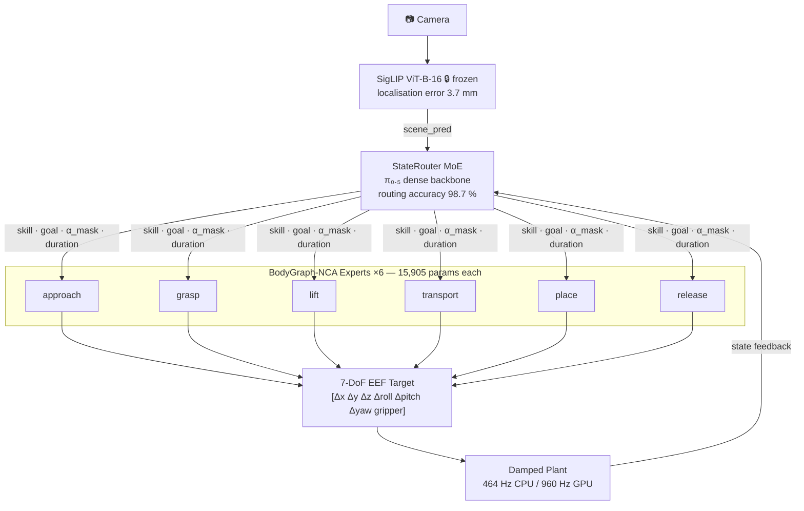
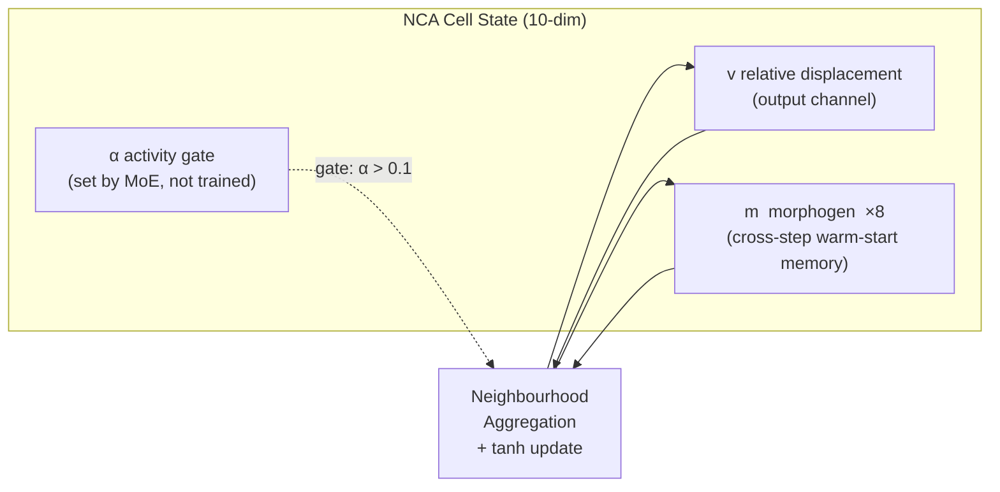
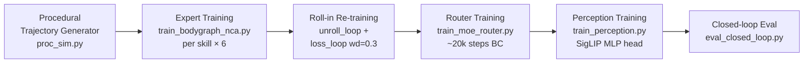
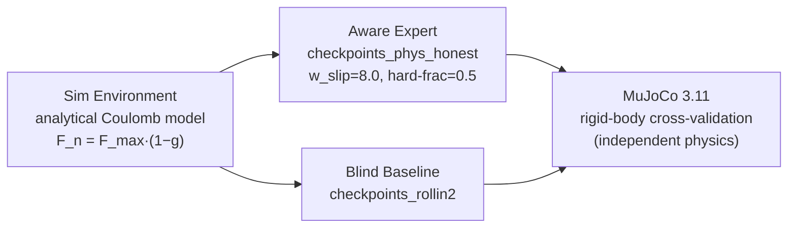

<div align="center">

# SomaVLA

**Hierarchical Robot Control via MoE Routing + Homogeneous NCA Experts**

[](https://www.python.org/)
[](https://pytorch.org/)
[](https://mujoco.org/)
[](LICENSE)

*Preliminary work for a master's thesis on lightweight VLA at Waseda University, Autonomous Mobile Robotics Lab.*

</div>

---

> **TL;DR** — SomaVLA validates a hierarchical embodied control architecture: a slow event-driven **MoE router** orchestrates six fast **homogeneous NCA experts** (each only **15,905 params**) running at **464 Hz on CPU**. A frozen SigLIP head provides visual scene grounding with **98.7 % end-to-end routing accuracy**. Full pick-and-place closed-loop success: **100 % (20/20)**.

---

## Architecture Overview



### NCA Cell State

Each NCA expert is a **homogeneous** body-graph network: seven EEF-pose DoF cells share one weight set, with no cell-type embedding or differentiation.



**Stability triad:** zero-init final layer · tanh-bounded updates · α-gate masking.

---

## Verification Gates (a → h)

| Gate | Description | Result |
|------|-------------|--------|
| **(a) Expert convergence** | 6 skills × 3 000 steps, lr = 1e-3 | ✅ 100 % · terminal err 0–1 mm |
| **(b) Drift re-convergence** | Inject ε ∈ {10, 20} mm at t₀ ∈ [30 %, 70 %] | ✅ Recovers to < 2.5 mm |
| **(c) Morphogen emergence** | 12-dim morphogen activity inspection | ✅ Cross-step warm-start forms |
| **(d) Scene parametric + MoE** | Random obj/place per episode; routing | ✅ 98.6 % routing, scenario-agnostic |
| **(d+VLM) SigLIP front-end** | Render → SigLIP → router end-to-end | ✅ 98.7 % (vs. GT 99.1 %, −0.4 pp) |
| **(e) Closed-loop assembly** | GT scene · 20 episodes | ✅ **20/20** (mean 31–32 steps) |
| **(f) Robustness** | +10 mm perturbation mid-lift, 15 trials | ✅ **15/15** |
| **(g) Inference speed** | CPU / GPU benchmark | ✅ **464 Hz / 960 Hz** (target ≥ 200/100) |
| **(h) Physics-aware planning** | Coulomb modal channel + MuJoCo cross-val | ✅/⚠️ See §4 of REPORT.md |

---

## Key Numbers at a Glance

| Metric | Value |
|--------|-------|
| Closed-loop success rate | **100 %** (20/20) |
| Robustness (perturbation) | **100 %** (15/15) |
| NCA expert parameters | **15,905** |
| CPU inference | **464 Hz** |
| GPU inference | **960 Hz** |
| Routing accuracy (SigLIP E2E) | **98.7 %** |
| SigLIP scene localisation | **3.7 mm** |
| Expert terminal error | **0–1 mm** |
| Re-convergence after +20 mm | **< 2.5 mm** |

---

## Training Pipeline



> **Critical fix for echo pathology:** naive sparse terminal supervision causes experts to learn `target ≈ reseed`. The `unroll_loop` + dense `hold-at-goal` loss (`wd=0.3`) is required for the closed loop to advance.

---

## Honest MuJoCo Validation

Gate (h) tests whether a physics-aware NCA expert (informed by a differentiable Coulomb friction channel) avoids object drops better than a blind baseline.



| Metric | Blind | Aware | Aware (ctx zeroed) |
|--------|-------|-------|--------------------|
| (h1) Success rate | 70 % (84/120) | **100 % (120/120)** | 100 % (120/120) |
| Drop count | 36 | **0** | 0 |
| Lift step size | ~55 mm (flat) | **24.8→38.3 mm** (monotone ↓) | ~26 mm (flat) |

**Honest conclusion:** the drop *outcome* claim is not reproduced by MuJoCo rigid-body physics (slip-rate discrepancy ~40–100×). The *mechanism* (margin-adaptive step-length reduction) is confirmed at modest scale (~2.3× less rigid-body slip).

---

## Repository Structure

```
SomaVLA/
├── soma/
│   ├── bodygraph_nca.py          # NCA expert (15,905 params)
│   ├── moe_router.py             # StateRouter + VLM variant
│   ├── bodygraph_controller.py   # Skill assembler + max-based completion
│   ├── physics.py                # Differentiable Coulomb model
│   └── gates.py                  # Gate verification helpers
├── scripts/
│   ├── proc_sim.py               # Procedural trajectory generator
│   ├── sim_env.py                # Simulation + Coulomb state machine
│   ├── train_bodygraph_nca.py    # Per-skill expert training
│   ├── train_moe_router.py       # Router + BC training
│   ├── train_perception.py       # SigLIP regression head
│   ├── eval_closed_loop.py       # End-to-end closed-loop eval
│   ├── eval_implicit_planning.py # Gate (h) physics-aware
│   └── eval_level_a.py           # MuJoCo independent cross-validation
├── checkpoints_rollin2/          # Blind baseline (6 skills)
├── checkpoints_phys_honest/      # Physics-aware  (Level A+)
├── assets/plan_field/            # Planning field assets
├── REPORT.md                     # ★ Full architecture + verification report
├── EXPERIMENT_SUMMARY.md         # Planning field (R9) experiments
├── REPORT_FIELD_INJECTION.md     # Field injection cost/feasibility
└── EXPERIMENT_LOG.md             # Detailed experiment log
```

---

## Quick Start

```bash
# 0. Environment
conda activate cerebvla

# 1. Train experts (run once per skill)
for skill in approach grasp lift transport place release; do
  python scripts/train_bodygraph_nca.py --skill $skill --out checkpoints_rollin2
done

# 2. Roll-in re-training (fixes echo pathology)
# (flag --rollin included by default in train_bodygraph_nca.py)

# 3. Train router
python scripts/train_moe_router.py

# 4. Train SigLIP perception head
python scripts/train_perception.py

# 5. Closed-loop evaluation
python scripts/eval_closed_loop.py --ckpt-dir checkpoints_phys_honest

# 6. Physics-aware gate (h)
python scripts/eval_implicit_planning.py \
  --aware-dir checkpoints_phys_honest \
  --blind-dir checkpoints_rollin2 \
  --n-cells 40 --eps 3 --hard-frac 0.5 --zero-ctx

# 7. MuJoCo independent validation
python scripts/eval_level_a.py --calib
python scripts/eval_level_a.py \
  --aware-dir checkpoints_phys_honest --n-cells 20 --eps 3
```

---

## Related Work

This project builds on:
- [OpenVLA](https://github.com/openvla/openvla) — vision-language-action model framework
- [Neural Cellular Automata](https://distill.pub/2020/growing-ca/) — emergent, self-organising cell dynamics
- [MuJoCo](https://mujoco.org/) — physics validation

---

## Citation

If you find this work useful, please cite:

```bibtex
@misc{wei2026somavla,
  author = {Wei, Zhuofan},
  title  = {SomaVLA: Hierarchical Robot Control via MoE Routing and Homogeneous NCA Experts},
  year   = {2026},
  url    = {https://github.com/Stockfish-2921769/SomaVLA}
}
```
