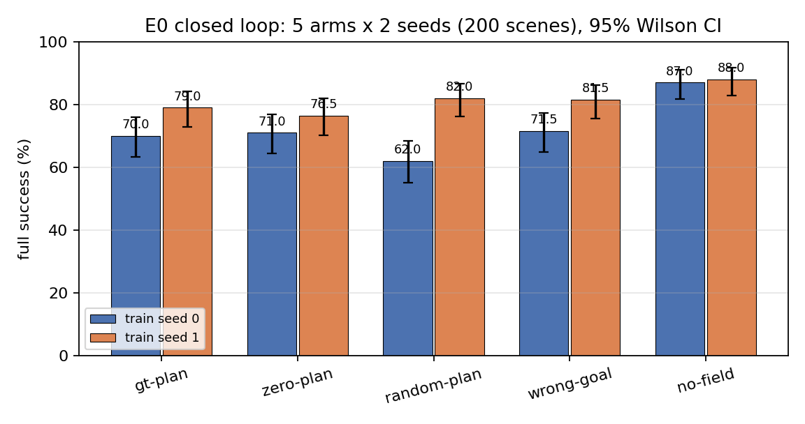
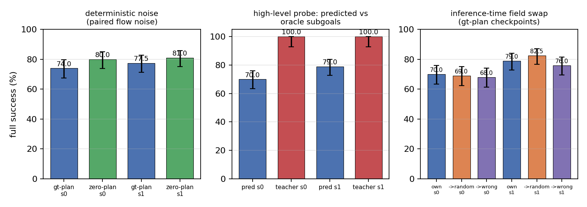

# SomaVLA — E0：场注入通道有效性（闭环验证）

> 日期：2026-10-19（2026-10-20 更新诊断）
> 状态：全部实验完成（5×2 主矩阵、场交换、teacher 诊断、确定性噪声敏感性、OOD）；
> E0 不通过，E1 暂缓
> 关联：`REPORT_E0_E1_PROTOCOL.md`（预注册方案）、`REPORT_FIELD_INJECTION.md`（成本评估）、
> `EXPERIMENT_LOG.md` 轴 F / 方法 2
>
> **结论先行**：通道结构上可用（场编码器梯度非零、离线信息量探针有效、推理时换场
> 会显著改变动作），但**闭环主对比 `gt-plan` vs `zero-plan` 无显著增益**：
> seed 0 −1.0 pp（单侧 p=0.6362），seed 1 +2.5 pp（p=0.3200），
> 合并 +0.8 pp（95% CI [−5.0,+6.2]，p=0.4345）；确定性噪声敏感性分析为 −4.8 pp
> （方向为负）。未达到预注册的通过或弱通过标准。按协议 **E0 不通过，E1 暂不启动**。
>
> **结论比“无增益”更强：当前注入实现是有损的。** `no-field` 臂在 s0/s1 达到
> **87%/88%**，显著高于所有场臂（62–82%；对 zero 的配对差 +16.0 pp / +11.5 pp）。
> 两个训练 seed 方向一致，排除了单一 seed 运气。
>
> **任务瓶颈另有其人（teacher 诊断）**：在同一 50 个场景上把高层预测子目标换成
> oracle 子目标后，`gt-plan` 从 s0 74.0%、s1 86.0% 双双升到 **100%**（各 50/50），
> 平均步数从 999/849 降到 **213/212**。高层子目标序列是主要瓶颈。因此 E0 的 null
> **不能**解读为“NCA/场对低层无用”；按预注册解释矩阵，应先修注入实现与高层，
> 再判断通道。

---

## 0. 结论摘要

### 0.1 预注册判据对照（主分析，seed 0）

| 判据 | 阈值 | 结果 | 结论 |
|---|---|---|---|
| `gt-plan` − `zero-plan` 成功率 | ≥ +10 pp | **−1.0 pp** | ✗ |
| 单侧配对 McNemar | p < 0.05 | **p = 0.6362** | ✗ |
| `random-plan` − `zero-plan` | < 5 pp | **seed 0：−9.0 pp** ✓；seed 1：+5.5 pp（p=0.207） | 基本满足（无显著优势） |
| 场交换成功率跌幅 | ≥ 5 pp | 四组交换跌幅 −3.5 ~ +3.0 pp（均 <5） | ✗ |

- **通过** ✗；**弱通过**（5–10 pp 且显著）✗；判定：**不通过**。
- seed 1 复现同样为负向结果（+2.5 pp，p=0.3200）。
- 合并两 seed：+0.8 pp，95% CI [−5.0,+6.2]；数据可以排除 ≥10 pp 的效应，
  但**不能排除 0–5 pp 的小效应**（见 §5.5 功效讨论）。

**两项事后但关键的发现**：

- **`no-field` 显著优于所有场臂**：87%/88%（s0/s1）vs 场臂 62–82%；
  对 zero 的配对差 +16.0 pp（p=0.0001）与 +11.5 pp（p=0.0076）。
  当前注入实现本身让策略变差，必须在 E1 前修复（§5.3）。
- **teacher 子目标在相同 50 场景上把 gt-plan 从 74%/86%（s0/s1）提到 100%**
  （各 50/50，213/212 步），说明任务主要瓶颈在高层；E0 的 null 不能解读为
  “场对低层无用”（§7）。

### 0.2 已经确认的事实

1. **注入通道不是死路**：场编码器梯度范数 0.55–0.75（各场臂），离线探针把
   waypoint MAE 从 0.63 cm（无 patch）降到 0.37 cm（局部场 patch），方向余弦中位数
   0.978；推理时换场使首个 action chunk 的归一化 L2 偏差中位数约 0.39。
2. **但闭环收益没有出现**：同分布 200 场景、两 seed，GT 测地场相对 zero-plan
   成功率差在 ±2.5 pp 内，且不显著；逐场景配对也显示两臂在多数场景上一致，
   差异场景正负均衡。
3. **评估方差是主要瓶颈之一**：同一臂跨 seed 的成功模式相关性 phi≈−0.1（接近独立），
   说明大量失败来自 flow-matching / 轨迹的随机性而非场景难度；200 场景的配对
   检验对 5–10 pp 效应功效不足。改用显式确定性噪声（同场景同决策两臂同噪声）后，
   GT 仍不优于 zero（合并 −4.8 pp，方向为负）。
4. **注入实现本身有损**：no-field 在 s0/s1 为 87%/88%，显著高于所有场臂
   （62–82%；对 zero 配对差 +16.0/+11.5 pp）。两 seed 方向一致，不能归为噪声。
5. **场内容可被任意替代**：GT→random 交换使首 chunk 动作变化
   （归一化 L2 0.40）但成功率不降（79.0%→82.5%）；wrong-goal 臂也不掉点。
6. **高层是任务的主要瓶颈**：同一 50 场景上，oracle teacher 子目标使 gt-plan
   s0/s1 均达到 50/50 (100%)、约 212 步；高层预测子目标下只有 74%/86%、
   999/849 步（全 200 场景为 70%/79%）。E0 的 null 必须在“高层误差主导”的
   前提下解读。

---

## 1. 设计与预注册判据

完整方案见 `REPORT_E0_E1_PROTOCOL.md` §3。要点：

- **任务**：3 个物体放到颜色匹配目标，两墙布局；成功 = 3/3 放置。
- **高层**：冻结的 visit-level 策略，每次 hover 输出一个子目标 `[gx,gy,gz,open]`。
- **低层**：SmolVLA-0.5B flow-matching action expert，receding horizon（chunk 8，
  执行 4），条件 = 图像 + 11 维 state（7 proprio + 4 子目标）+ 64 个场 token。
- **只改场条件**，其余（数据、标签、高层、预算、场景、评估协议）全部固定。

| 臂 | 场 token | plan 通道 |
|---|---|---|
| `no-field` | 无 | — |
| `zero-plan` | 有 | 全零 |
| `random-plan` | 有 | 平滑随机势场（低通） |
| `wrong-goal` | 有 | GT 场换随机空格目标 |
| **`gt-plan`** | 有 | 当前子目标的精确测地场 |

- **主对比**：`gt-plan` vs `zero-plan`（预注册 seed 0；seed 1 复现）。
- **统计**：场景级配对精确 McNemar（单侧）；成功率差用场景级 bootstrap 95% CI；
  次要比较 Holm 校正。

---

## 2. 实现与训练

### 2.1 数据

- 600 个两墙场景，GT 场路由的 scripted teacher 生成动作标签；2 个 episode 失败。
- 共 **25,004 个 chunk（H=8）、4,806 个 visit**；每个 visit 平均 5.2 个 chunk。
- 场为 64×64×4 世界坐标通道 `[obstacle, plan, dx/G, dy/G]`，plan 为
  8-连通 Dijkstra 测地距离 /(2G)。
- 约 14% 的 chunk 位于绕墙段（路径/直线距离 >1.2），数据不是纯直行。

### 2.2 注入

- `FieldEncoder`：4→32→64→128（stride 2），8×8=64 token，Linear 到 VLM hidden 960。
- 场 token 插在 state token 之前；`pad_mask=1`，`att_mask=0`。
- 场编码器 217.8K 参数；expert 可训练 99.88M；VLM 冻结。
- 场在每个 chunk 边界从当前环境重算；visit 内子目标固定。

### 2.3 训练

- 所有臂固定 **15K steps**，batch 16，AdamW（expert 1e-4 / encoder 3e-4），
  wd 1e-5，grad clip 1.0，bf16；**不按 val MSE 早停或选模**。
- 15% field dropout。
- 各臂末步训练损失与场梯度：

| 臂 | seed | final loss | field grad |
|---|---|---|---|
| gt-plan | 0 / 1 | 0.0191 / 0.0175 | 0.621 / 0.610 |
| zero-plan | 0 / 1 | 0.0188 / 0.0174 | 0.549 / 0.583 |
| random-plan | 0 / 1 | 0.0190 / 0.0176 | 0.754 / 0.561 |
| wrong-goal | 0 / 1 | 0.0192 / 0.0177 | 0.657 / 0.638 |
| no-field | 0 / 1 | 0.0169 / 0.0182 | — |

各场臂损失与 no-field 同级（差 ≤0.002），场条件没有造成优化困难。

---

## 3. 评估器正确性与验证

E0 评估在实现过程中发现并修复了 4 个会改变结论的 bug，记录如下（详见
`scripts/eval_field_expert.py`、`scripts/eval_field_expert_vec.py` 与
`EXPERIMENT_LOG.md`）：

1. **顺序评估器 stale state（严重）**：`run_episode` 在 scripted lift 之后没有刷新
   `state`，导致第二次及以后的 visit 使用抬升前的位姿。修复后 teacher-subgoal
   从约 0–1/8 变为 8/8、visit 成功率 100%。
2. **arm→field 映射错误（严重）**：`--field-override ckpt` 对所有臂都解析成 GT 场，
   等于用 GT 场评估 zero/random/wrong 臂。修复为按 checkpoint 的 `arm` 显式映射，
   并在日志中打印实际场源。
3. **批量预测截断**：批量 `_predict` 把 8 行错误地 reshape 成 `[8,7]` 后取前 8 行，
   只保留第一个 episode 的 chunk。修复为 `[B,-1,7][:, :H]`。
4. **向量化 lift 插值**：使用递减计数器作分母，导致 z 轨迹加速且 xy 漂移；
   修复为固定 10 步、捕获起点 xy/z/grip，与顺序版 `lift_scripted` 逐点一致。

**向量化 ↔ 顺序一致性**：同场景下首个 chunk 的图像、归一化 state、场、动作
逐位一致（maxdiff 0.0）；teacher-subgoal 两版均 8/8。批量评估吞吐约
8.7 s/ep（batch 16）vs 顺序 68 s/ep。

**噪声语义（重要）**：E0 使用 lockstep 批量评估，所有臂共享每个场景的 plant 噪声
流，但 **flow-matching 噪声流在轨迹分叉后不再保证逐 query 一致**。这不会破坏
场景级配对检验的有效性，但会增大配对方差、降低功效（见 §5.4）。

**指标修正**：基于 stale-state bug 曾提出把 exec-stride 从 4 改为 2；bug 修复后
exec 4 与 2 的 teacher 结果同为 8/8，故**撤回该修正**，恢复训练一致的 exec 4。

---

## 4. 离线门（E0a 与 pilot）

| 门 | 结果 |
|---|---|
| 梯度门（50 步） | field encoder grad 0.351，非零；显存 <24 GB |
| 过拟合门（64 chunks） | loss 6.67→0.189（gt）/ 6.79→0.198（zero），均收敛 |
| 回放门 | 动作标签开环回放 target-command 误差 **0.000 cm** |
| 信息量探针 | 留出场景 waypoint MAE **0.37 cm**（无 patch 0.63，常数基线 2.17）；方向余弦 mean 0.550 / median 0.978，>0.5 占 65%；步长预测 2.11 cm vs 真值 2.17 cm |

**离线门全部通过**。探针说明局部场 patch 确实含有可线性读取的方向/步长信息，
排除了坐标、分辨率、归一化层面的低级错误；但这也说明通道“有信息”不等于
闭环“用得上”。

---

## 5. 闭环主结果

### 5.1 各臂（200 场景，seed 777 评估场景）

| 臂 | seed | 全成功 | 放置数 | bumps/ep | wall_hits/ep | steps/ep | visit 成功 |
|---|---|---|---|---|---|---|---|
| gt-plan | 0 | **140/200 (70.0%)** | 2.56 | 0.10 | 10.0 | 1000 | 1254/2083 (60.2%) |
| zero-plan | 0 | **142/200 (71.0%)** | 2.59 | 0.12 | 17.3 | 956 | 1296/2064 (62.8%) |
| gt-plan | 1 | **158/200 (79.0%)** | 2.70 | 0.21 | 9.7 | 945 | 1318/2071 (63.6%) |
| zero-plan | 1 | **153/200 (76.5%)** | 2.65 | 0.23 | 13.2 | 920 | 1226/1976 (62.0%) |
| random-plan | 1 | 164/200 (82.0%) | 2.75 | 0.10 | 7.7 | 902 | 1324/2037 (65.0%) |
| random-plan | 0 | 124/200 (62.0%) | 2.45 | 0.18 | 12.8 | 1054 | 1216/2104 (57.8%) |
| wrong-goal | 1 | 163/200 (81.5%) | 2.69 | 0.12 | 5.2 | 845 | 1287/1940 (66.3%) |
| wrong-goal | 0 | 143/200 (71.5%) | 2.53 | 0.17 | 23.6 | 991 | 1326/2138 (62.0%) |
| **no-field** | 0 | **174/200 (87.0%)** | 2.81 | 0.09 | 12.9 | 789 | 1312/1921 (68.3%) |
| **no-field** | 1 | **176/200 (88.0%)** | 2.83 | 0.09 | 6.8 | 771 | 1260/1862 (67.7%) |



### 5.2 预注册主对比

| seed | gt | zero | 差值 | bootstrap 95% CI | 不一致对（gt胜/zero胜） | 单侧 McNemar |
|---|---|---|---|---|---|---|
| **0（预注册）** | 70.0% | 71.0% | **−1.0 pp** | [−9.5, +7.5] | +36 / −38 | **p = 0.6362** |
| 1（复现） | 79.0% | 76.5% | +2.5 pp | [−6.0, +11.0] | +39 / −34 | p = 0.3200 |
| 合并（分层） | — | — | **+0.8 pp** | [−5.0, +6.2] | +75 / −72 | p = 0.4345 |

**判定：不通过。** 两个 seed 的方向相反；合并不一致对几乎相等（75 vs 72）。

### 5.3 关键控制：`no-field` 优于所有场臂

这不是预注册主对比，但它是“新增 token/编码器容量”的核心控制臂：

| seed | no-field | zero | gt | no-field − zero | 95% CI | 不一致对 | 双侧 p |
|---|---|---|---|---|---|---|---|
| 0 | **87.0%** | 71.0% | 70.0% | **+16.0 pp** | [+8.0,+24.0] | +50 / −18 | 0.0001 |
| 1 | **88.0%** | 76.5% | 79.0% | **+11.5 pp** | [+3.5,+19.5] | +46 / −23 | 0.0076 |

合并两 seed：no-field − zero = **+13.8 pp**，95% CI [+8.2,+19.2]，
不一致对 +96/−41（单侧 p<0.0001）。no-field 与 gt 的同 seed 对比为 +17.0 pp
（s0，p<0.0001）与 +9.0 pp（s1，p=0.0198）。两个训练 seed 方向一致、均显著。**结论：坏消息比“场无用”更强——按当前注入实现，
加 64 个场 token 会让预训练策略变差 9–17 pp**。no-field 只少了 217.8K 场编码器参数
（报告时需注明），但两 seed 一致的显著差异不能简单归因于参数少。

可能原因：64 个 token 插在 state token 前改变了 prefix 长度/位置与注意力分配、
稀释了有限的 expert 注意力，或场编码器在 15K 步内未与冻结 VLM 表征对齐。
这必须在 E1 之前修掉，否则任何场来源（包括 NCA）都会被同一个通道惩罚。

### 5.4 次要配对指标（gt − zero）

| seed | 放置数 | bumps | wall_hits（均值） | wall_hits（中位数） | steps |
|---|---|---|---|---|---|
| 0 | −0.04 [−0.17,+0.10] | −0.03 | −7.28 | 1 vs 2 | +44 [−44,+132] |
| 1 | +0.04 [−0.08,+0.17] | −0.03 | −3.50 | 2 vs 2 | +25 [−60,+109] |

wall_hits 的均值差由少数长尾 episode 支配（seed 0 最大值 586 vs 731；p95 14 vs 118），
配对符号检验不显著（seed 0：GT 更少 82、更多 63、平 55）。**不能声称 GT 场
显著减少撞墙**。

### 5.5 可靠性、方差与功效

- **跨 seed 一致性**：同一臂 s0/s1 的逐场景成功模式 phi = −0.096（gt）、−0.068（zero）；
  两 seed 都成功的场景仅 107/200（gt）。即**场景难度对成功率的解释力很弱**，
  大量成功/失败是 run-specific 的。
- **同 seed 内两臂一致性**：gt vs zero phi = +0.111（s0）、−0.054（s1）；
  random vs zero phi = +0.044（s0）、+0.047（s1）。
- **训练 seed 本身的方差很大**：同一臂跨 seed 成功率差 gt 9.0 pp、zero 5.5 pp、
  **random 20.0 pp**（62.0% vs 82.0%）；random 跨 seed phi = −0.045。
  这给出单臂比较的噪声尺度：任何 <10 pp 的臂间差异都可能来自训练随机性。
- **功效模拟**（n=200，p_zero=0.71，高斯 copula 潜变量模型；模型给出的
  不一致对数量与观测的约 74 对/200、方向近对半一致）：

  | 真实效应 | 潜相关 r=0（接近观测） | r=0.5（更有利） |
  |---|---|---|
  | +5 pp | 26% | 34% |
  | +10 pp | 71% | 85% |

  **含义**：对预注册的 +10 pp 门槛，本设计功效约 7 成——即使真实效应为 +10 pp，
  单个 seed 仍可能漏检；对 5 pp 效应功效只有约三成。这不是“实验没做对”，而是
  200 个高随机性场景的固有限制。当前两个 seed 方向相反（−1.0 / +2.5 pp）与
  “真实效应 <5 pp”的假设一致，但也与“真实效应 5–10 pp 且被噪声掩盖”一致。
- 合并 95% CI 上限 +6.2 pp：**数据可排除 ≥10 pp 的通道增益**，
  但不能排除 0–5 pp 的小效应；5–10 pp 区间处于功效不足地带。

### 5.6 确定性噪声敏感性分析（事后，非预注册）

为直接检验“flow-matching 噪声掩盖了配对效应”，新增 `--det-noise`：把噪声按
`(scene_id, 决策序号)` 确定性生成并作为显式 `noise` 传给 `predict_action_chunk`，
使两臂在**同一场景、同一次决策**上看到完全相同的噪声（已用重复运行验证逐位可复现）。
用该模式重跑 gt / zero，两个 seed 各 200 场景：

| seed | gt | zero | 差值 | 95% CI | 不一致对（gt胜/zero胜） | 单侧 McNemar |
|---|---|---|---|---|---|---|
| 0 | 74.0% | 80.0% | **−6.0 pp** | [−14.0, +2.0] | +27 / −39 | 0.9456 |
| 1 | 77.5% | 81.0% | **−3.5 pp** | [−11.5, +5.0] | +31 / −38 | 0.8322 |
| 合并 | — | — | **−4.8 pp** | [−10.5, +1.0] | +58 / −77 | 0.9576 |

**结论未变，且方向为负**：降低噪声后方差确实略降（不一致对 s0 74→66），但 GT 在两个
seed 都低于 zero。该分析只作为敏感性检查，不用于重新判定预注册结果；它强化了
“GT 场没有带来可检测收益”的结论。

顺带验证：deterministic 模式重跑 random-plan 臂得到 125/200（s0）与 164/200（s1），
与随机噪声版的 124/200、164/200 几乎一致——说明该模式不改变臂的边际水平，
只固定配对噪声。

### 5.7 失败形态

| 臂 | 成功步数（均值） | 失败步数（均值） | 失败全部为 1500 步超时 | 失败时已放置 2/3 |
|---|---|---|---|---|
| gt-plan s0 | 786 | 1500 | 60/60 | 34/60 |
| zero-plan s0 | 734 | 1500 | 58/58 | 37/58 |
| gt-plan s1 | 797 | 1500 | 42/42 | 26/42 |
| zero-plan s1 | 742 | 1500 | 47/47 | 29/47 |

**所有失败都是 episode 长度耗尽，没有“提前卡死”**；多数失败已完成 2/3 放置。
成功 episode 平均只需 734–797 步，而 teacher 子目标下仅约 247 步——说明
**主要瓶颈是达成长程目标的效率（高层子目标序列 + 重规划），不是单次抓取/放置**。
GT 场的成功 episode 反而比 zero 多约 50 步，进一步说明场没有改善执行效率。

---

## 6. 场交换（E0c）

对 `gt-plan` 训练后的模型，在推理时把场替换为 random / wrong-goal，同一 200 场景、
同一 checkpoint。记录成功率跌幅与首个 action chunk 的归一化 L2 偏差。

| 模型 | 交换 | 成功率 | 跌幅（自身 − 交换） | 首 chunk L2 偏差（中位数） |
|---|---|---|---|---|
| gt-plan s0 | GT（自身） | 70.0% | — | — |
| gt-plan s0 | → random | **138/200 (69.0%)** | **+1.0 pp** | 0.3603 |
| gt-plan s0 | → wrong-goal | **136/200 (68.0%)** | **+2.0 pp** | 0.3750 |
| gt-plan s1 | GT（自身） | 79.0% | — | — |
| gt-plan s1 | → random | **165/200 (82.5%)** | **−3.5 pp（无跌幅）** | 0.4021 |
| gt-plan s1 | → wrong-goal | **152/200 (76.0%)** | **+3.0 pp** | 0.3627 |

**目的**：区分“场被读取但无收益”与“场根本没进入决策”。若 L2 偏差大而成功率
不降，说明模型读取了场但未用于成功所需的关键决策；若偏差小，说明注入被忽略。

**四组交换全部未达到 ≥5 pp 跌幅**：GT→random 在 s0/s1 分别为跌幅 +1.0 / −3.5 pp，
GT→wrong-goal 在 s0/s1 为跌幅 +2.0 / +3.0 pp；而首个 chunk 的归一化 L2 偏差中位数
都在 0.36–0.40。即 **场进入了动作决策，但其空间内容不是成功的
必要条件**——这与 wrong-goal/random 训练臂不掉点一致。交换判据不通过，且失败方向
说明“模态坍缩”的简单解释（模型完全忽略场）不成立，更准确的说法是**场被读取但可被
任意替代**。

---

## 7. teacher 子目标诊断

`gt-plan` × 2 seeds × 50 场景，用 oracle nearest-first 子目标替换高层预测，
分离高层误差与低层执行误差。

| 设置 | seed 0 | seed 1 |
|---|---|---|
| 高层预测子目标（全 200 eps） | 70.0% | 79.0% |
| 高层预测子目标（同一 50 场景） | 74.0%（999 步） | 86.0%（849 步） |
| **teacher 子目标（50 eps）** | **50/50 (100%)，213 步** | **50/50 (100%)，212 步** |

teacher 子目标在两个 seed 上都把 50 个场景全部做成功：s0 74.0%→100%，
s1 86.0%→100%，步数降到约 1/4。小样本 smoke（4 eps，gt-plan s0）同样 4/4、247 steps/ep。
注意前 50 个场景比全 200 场景更容易（s0 74% vs 70%，s1 86% vs 79%），
因此对照必须用同一批 50 场景。



**这是 E0 最关键的解释性结果**：在同一个低层 expert、同一个场条件下，只要把高层
预测子目标换成 oracle nearest-first 子目标，长程任务几乎变成满分。因此
**瓶颈在高层子目标序列，而不是低层执行或场注入通道**。按预注册解释矩阵，
此时不应据此判断注入通道的因果贡献；E0 的 null 不能解释为“场对低层无效”，
而是“在高层错误占主导的任务上，低层场的差异被淹没”。

---

## 8. OOD（次要）

40 个随机墙布局，gt / zero / random × 2 seeds。E0 只报告、不调参。

| 臂 | seed | 成功 | 放置数 | wall_hits/ep | steps/ep |
|---|---|---|---|---|---|
| gt-plan | 1 | 34/40 (85.0%) | 2.73 | 1.8 | 902 |
| zero-plan | 1 | 31/40 (77.5%) | 2.73 | 1.2 | 799 |
| random-plan | 1 | 36/40 (90.0%) | 2.90 | 0.7 | 784 |
| gt-plan | 0 | 24/40 (60.0%) | 2.42 | 0.5 | 986 |
| zero-plan | 0 | 30/40 (75.0%) | 2.62 | 5.3 | 961 |
| random-plan | 0 | 34/40 (85.0%) | 2.80 | 0.8 | 892 |

n=40 时配对检验功效很低，以上只作描述性报告。两 seed 的 gt−zero 方向相反
（s0 −15.0 pp，24 vs 30；s1 +7.5 pp，34 vs 31），与“无稳定效应”一致。
random 墙布局的 wall_hits 为 0.5–5.3，多数低于同分布两墙场景（5.2–23.6）；
场景生成方式也不同，OOD 成功率不宜与同分布数值直接比较。

---

## 9. 解释与失败模式

按协议 §3.6 的解释矩阵：

| 观察 | 当前证据 | 解释 |
|---|---|---|
| GT ≈ zero（成功率） | 是（−1.0/+2.5 pp，不显著） | 闭环没有可检测的通道收益 |
| random vs zero | s0 −9.0 pp，s1 +5.5 pp（不显著），合并 −1.75 pp | random 无系统性优势，排除“任意结构信号即可”的解释 |
| wrong-goal vs zero | s0 +0.5 pp、s1 +5.0 pp（均不显著） | **目标对齐不必要**：把 plan 换成错误目标也不掉点，说明 plan 通道内容基本未被使用 |
| 场交换跌幅 | 四组 −3.5 ~ +3.0 pp（均 <5；L2 dev 0.36–0.40） | 场被读取但内容可任意替代 |
| **no-field vs 场臂** | **两 seed 均高 9–17 pp，显著** | **注入通道本身有害**，不是简单的“场无用” |
| 离线探针有效 | 是（0.37 cm，cos 0.978） | 排除坐标/分辨率/归一化错误 |
| 场编码器梯度非零 | 是（0.55–0.75） | 排除“场分支未训练” |
| teacher vs 预测子目标 | 同一 50 场景 100% vs 74%/86%，212 vs 999/849 步 | **高层是主要瓶颈** |

**目前最可能的解释**（按证据强度）：

1. **注入实现本身有损**：no-field 在 s0/s1 分别 87%/88%，显著高于所有场臂
   （62–82%）。这不是“信息冗余”（冗余应中性），而是 64 个 prefix token /
   位置偏移 / 注意力稀释造成的退化和优化干扰。需在 E1 前修复。
2. **高层是任务主要瓶颈**：teacher 子目标把 gt-plan s1 从 79%（945 步）提升到
   100%（212 步）。低层 visit 成功率各臂几乎相同（60–68%），full success 由
   高层子目标序列与长程效率决定。
3. **场内容未被用于成功**：GT≈zero≈random≈wrong-goal，交换场不掉点，且
   wrong-goal 臂不掉点。模型可能读取场（首 chunk 动作变化）但未将其用于
   到达/放置所需的关键决策。
4. **场景级成功率被随机性主导**：跨 seed phi≈0 说明约 30% 的失败并非固定难场景，
   而是随机的执行失败/超时；这会掩盖小的场效应。

---

## 10. 结论与下一步

### 10.1 E0 判定

**不通过**。按预注册协议：不启动 E1（NCA vs Euclid 归因）。
诊断给出的失败归因有两条：**注入实现本身有损**（no-field 高 9–17 pp）与
**高层瓶颈**（同一 50 场景 teacher 100% vs 预测 74%/86%），而不是
“场对低层执行无用”。

### 10.2 下一步（按优先级）

1. **修复注入实现（最高优先）**：先做等参数控制——给 no-field 臂加同样约 218K 的
   无关 MLP（接在 state 上），区分“参数少”与“64 token 注入/位置偏移/注意力稀释”。
   再按协议尝试 FiLM/adaLN（参数下限）、KV adapter（信息上限）、减少 token 数
   （如 16/32）、把场 token 放到 state 之后或单独序列；必要时解冻 VLM 最后 2–4 层。
   **验收标准：场臂至少追平 no-field**，否则任何场来源（包括 NCA）都会被同一惩罚。
2. **修高层**：同一 50 场景上 teacher 子目标 100% vs 预测子目标 74%/86%
   （s0/s1），步数 212 vs 999/849，高层子目标选择/顺序/终止是主要损失来源。
   修好之前，低层效应仍会被淹没。可选方向：更强的 visit 级决策数据/训练、
   高层引入全局视图、直接优化“是否卡住/每步推进量”。
3. **降低评估方差**：已实现确定性噪声并通过敏感性分析（同场景同决策两臂同噪声，
   重复运行逐位可复现）；后续正式评估建议默认采用 `--det-noise`，把 5–10 pp 区间
   的功效提上来。
4. **确认场被用于哪些决策**：完成场交换（s0 与 wrong-goal）；做“只留 dx/dy 通道”
   消融；目前 s1 的 GT→random 不掉点说明内容未被用于成功所需决策。
5. **提高任务对场的依赖**：换更需要绕行的场景（更长墙、窄通道）或遮挡/部分观测，
   让局部场成为成功必要条件；这也与 E1 的可证伪设定一致。
6. **更多 seed**：协议允许临界对比补第 3 个 seed；在修注入与高层、降方差之后再补。

### 10.3 对 E1 的含义

E0 不通过意味着当前**不能**判断“NCA 场是否优于 Euclid”。由于 no-field 显著优于
所有场臂，E1 不仅需要“GT 出现收益”，还需要先证明**注入通道本身不再有损**
（场臂 ≥ no-field）。在通道修复并验证之前启动 E1，只会测到同一个注入惩罚如何
作用于不同场来源，无法回答 NCA 特异性的问题。高层的修复可以并行推进。

---

## 附录：复现

```bash
# 数据
python scripts/gen_multi_lowlevel.py --out data/multi_lowlevel_2w.npz ...
# 训练（每臂 15K steps）
python scripts/train_field_expert.py --arm gt-plan --seed 0 ...
# 闭环评估（批量）
python scripts/eval_field_expert_vec.py \
  --ckpt ckpts/e0/gt-plan_s0/last.pt --exec-steps 4 \
  --n-episodes 200 --seed 777 \
  --json-out logs/e0/vec_gt-plan_s0.json
# 配对分析
python scripts/analyze_e0.py logs/e0/vec_*_s{0,1}.json \
  --main vec_gt-plan_s0 vec_zero-plan_s0 --pooled gt-plan zero-plan
```

产物：`ckpts/e0/{arm}_s{seed}/last.pt`、`logs/e0/vec_*.json`、
`logs/e0/pilot_*.log`、`logs/e0/probe_r*.log`。
